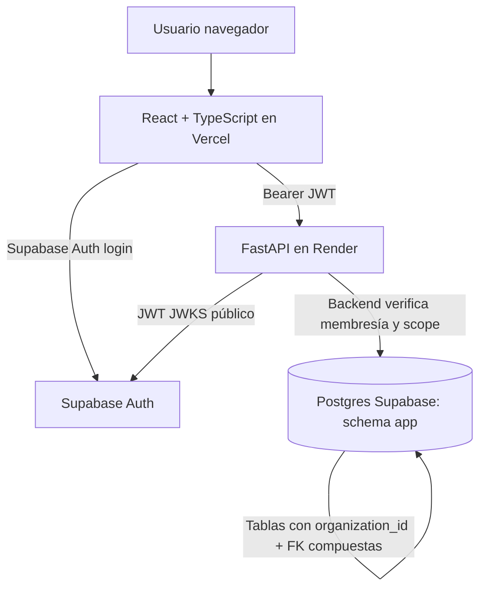

# Arquitectura inicial · Vista rápida

**Seguridad:** la conexión privilegiada del backend a Postgres no se confunde
con una garantía RLS. FastAPI comprueba sujeto, membresía y derechos antes de
consultar o mutar datos. Las reglas de permisos granulares y un rol runtime
restringido se completan en Sprint 1.

**Costo:** el entrenamiento PyTorch, MLflow, Redis, colas y tareas intensivas
quedan fuera de Render Free en esta etapa. La arquitectura de los PDF los prevé,
pero se integrarán cuando exista capacidad computacional y datos autorizados.
