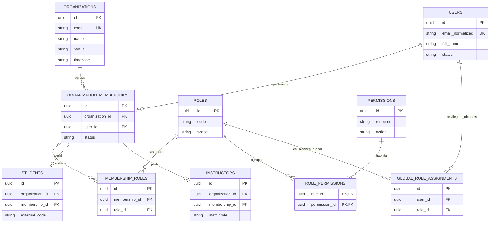
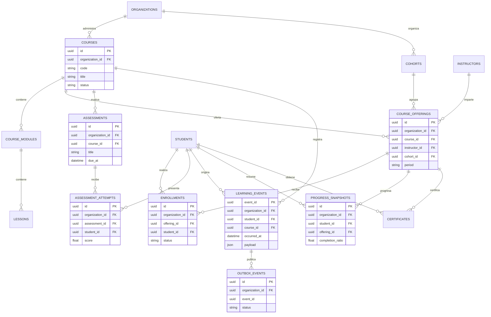

# EduMaster.ai — Sprint 0
## Propuesta de diseño multiinstitución: RBAC/ABAC y modelo entidad-relación

**Versión:** 1.0 de trabajo · **Fecha:** 19/11/2026  
**Estado:** borrador para revisión funcional, arquitectura, seguridad y Data Owner.  
**Decisión aprobada:** ADR-001: multiinstitución desde el primer despliegue.  
**Entregables relacionados:** S0-04 (RBAC/ABAC) y S0-05 (ERD preliminar).  
**Backlog:** EM-RQ-001 a EM-RQ-010, EM-RQ-022 a 050, EM-RQ-087 a 095, entre otros.

### Documentos fuente
1. `Documentacion_EduMaster_AI_Enterprise.pdf` (DM, 22 páginas): §3, página 5 (perfiles y matriz), §6, páginas 9–10 (arquitectura y límites), §7, páginas 10–11 (entidades e integridad), §10, página 15 (API/eventos), §11, página 16 (seguridad).
2. `EduMaster_AI_Manual_Funcionamiento_Procedimientos_Enterprise.pdf` (MI, 19 páginas): §3, páginas 4–5 (perfiles/autorización), §6–7, páginas 8–10 (arquitectura/modelo/eventos), §10, páginas 12–13 (realtime), §12, página 14 (seguridad).

**Importante:** los PDF describen los perfiles, los accesos básicos, las entidades del dominio y el uso de `organization_id` en entidades institucionales. No contienen una implementación completa de permisos por endpoint ni el diseño cerrado de todas las claves/relaciones. La matriz detallada y las tablas adicionales están expresamente **propuestas**, no aprobadas.

### 1. Decisión base y propuesta de identidad

**Aprobado por Product Owner (ADR-001):** EduMaster.ai soportará múltiples instituciones desde la V1.

**Propuesta pendiente ADR-016:** mantener `users` como identidad global, y administrar las asociaciones a instituciones mediante `organization_memberships`. Un usuario podrá pertenecer a A y B con distintos roles y estado de membresía. La alternativa literal del documento maestro es `users.organization_id`, que representa pertenencia directa y necesitaría duplicar la identidad o introducir otra estrategia para múltiples pertenencias.

La decisión de cuál variante adoptar es importante: **no se considera resuelta por la aprobación de multiinstitución**. Debe validarse junto con OIDC/OAuth2, las políticas de cuentas y la experiencia de cambio de institución.

### 2. Diagrama ER — Identidad y autorizaciones

### 3. Diagrama ER — Académico y aprendizaje

**Lectura del diagrama:** las relaciones anteriores son conceptuales. `outbox_events` debe poder publicar eventos de agregados distintos de `learning_events`; la relación dibujada ilustra un caso de uso y no obliga a implementar una FK física universal. En particular, el patrón Outbox exige transacción consistente entre cambio de negocio y evento pendiente.

### 4. Dominios complementarios en la matriz

La hoja **ER Entidades** incluye además rutas (`learning_paths`, `path_steps`, `path_assignments`), competencias (`skills`, `course_skills`, `skill_evidence`), analítica (`progress_snapshots`), IA/MLOps (`datasets`, `model_runs`, `model_versions`, `predictions`, `recommendations`, `recommendation_feedback`), gobierno (`audit_logs`) y notificaciones.

En estos dominios, los campos exactos, los índices y el alcance del modelo institucional (por ejemplo, si habrá un modelo neuronal global compartido) siguen sujetos a ADR. **No se debe aplicar una migración a producción a partir de este diagrama sin refinamiento y revisión.**

### 5. Principios de integridad obligatorios

- **Tenant como límite de seguridad:** agregar `organization_id` a las entidades institucionales, filtrarlo y validarlo en el backend en todas las operaciones.
- **No confiar en el cliente:** un `organization_id` recibido en ruta/header/payload no concede acceso. El servidor deriva y comprueba el contexto desde la identidad, membresía activa y permisos.
- **Referencias cruzadas protegidas:** como propuesta, definir FK compuestas `(organization_id, reference_id)` hacia claves únicas equivalentes del padre; así no se puede matricular a un estudiante B en una oferta A.
- **Identificadores UUID** y **timestamps UTC**, con presentación usando zona horaria institucional.
- **Catálogos y códigos:** unicidad de `courses(organization_id, code)` y de otras claves de negocio por institución.
- **Acceso mínimo:** permisos definidos como acción/recurso + contexto; denegación por defecto; superadministración no significa lectura irrestricta de información sensible.
- **Defensa en profundidad:** Row Level Security es un mecanismo adicional recomendado para evaluación (ADR-004), no una decisión aprobada ni sustituto de permisos en API.
- **Datos y auditoría:** no mezclar datos identificadores en datasets ML salvo excepción aprobada; registrar acciones críticas, exportaciones y cambios de roles.
- **Tiempo real:** suscripciones SSE/WebSocket autorizadas por institución, curso y usuario; no usar canales globales sin filtros.

### 6. Políticas RBAC/ABAC

En **RBAC Accesos** hay 39 operaciones de negocio con decisiones propuestas para ocho roles. Los códigos significan:

| Código | Significado |
|---|---|
| G | Acción global explícita, auditada |
| I | Dentro del tenant del usuario |
| AS | Solo cursos/grupos asignados |
| P | Solo registros propios |
| AG | Lectura/consulta agregada |
| PS | Dataset seudonimizado y autorizado |
| AP | Requiere aprobación adicional |
| PUB | Verificación pública limitada |
| NO | Denegado |

**La columna de rol nunca basta por sí sola.** Una operación se permite sólo si pasa las condiciones **ABAC Reglas**: identidad, membresía, tenant efectivo, relación con curso/cohorte, propiedad del dato, estado, ventana temporal y restricciones de privacidad.

### 7. Casos críticos de aceptación

Los casos `T-01` a `T-22` están definidos en **Pruebas Tenant**. Los más prioritarios:

1. Una cuenta de institución A no puede leer ni modificar curso, matrícula o calificación de B.
2. Una cuenta presente en A y B no hereda automáticamente los roles de una institución a otra.
3. Alterar `organization_id` en una solicitud no cambia permisos.
4. Una matrícula que relaciona estudiante A y oferta B es rechazada.
5. Un administrador de A no puede otorgarse superadministración global.
6. Un docente sólo accede a evaluaciones de sus ofertas/grupos asignados.
7. Un evento realtime de B nunca se entrega a un suscriptor no autorizado de A.
8. Un dataset, modelo o exportación no se comparte con otra institución sin base y permiso documentados.

### 8. Criterios de salida S0-04 y S0-05

**S0-04:** matriz revisada y aceptada por PO/Seguridad; conflictos resueltos; roles y excepciones documentados; pruebas negativas aprobadas para implementar en Sprint 1.

**S0-05:** ERD revisado por Backend/DBA; decisiones sobre `users` y membresías aprobadas; constraints de tenant consistentes; reglas de altas/bajas y ciclos de vida acordadas; migraciones pendientes para Sprint 1.

### 9. Decisiones que aún requieren confirmación

- `ADR-016`: identidad única + membresías N:M versus cuenta específica por institución.
- `ADR-017`: restricción con FK compuestas / claves candidatas `(organization_id,id)`.
- `ADR-002`: permisos exactos de delegación, lectura de notas, aprobaciones y superadministración.
- `ADR-004`: implementación de PostgreSQL RLS.
- `ADR-018`: nivel de acceso excepcional del superadministrador.
- `ADR-019`: modelos/datasets globales o institucionales.
- `ADR-020`: alcance de autorización y reconexión en realtime, documentos y exportaciones.

**Conclusión:** se dispone de una propuesta detallada, trazable y verificable, sin presentar los aspectos pendientes como decisiones ya aprobadas. La siguiente sesión de Sprint 0 debería resolver ADR-016 antes de transformar este modelo lógico en migraciones PostgreSQL.
